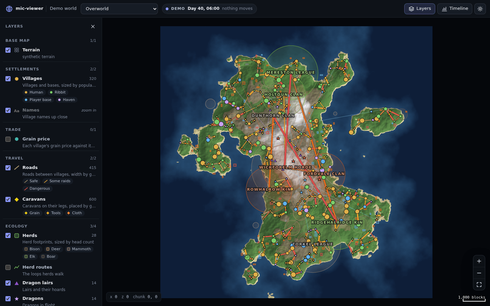
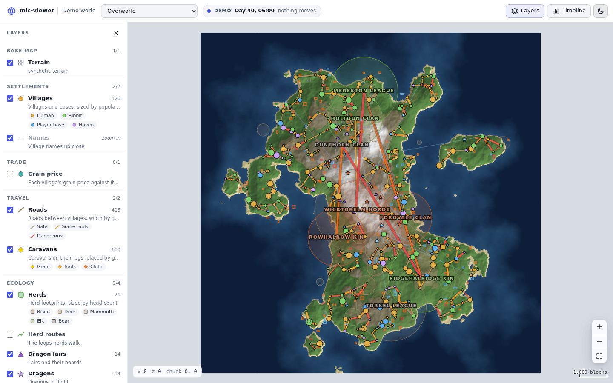
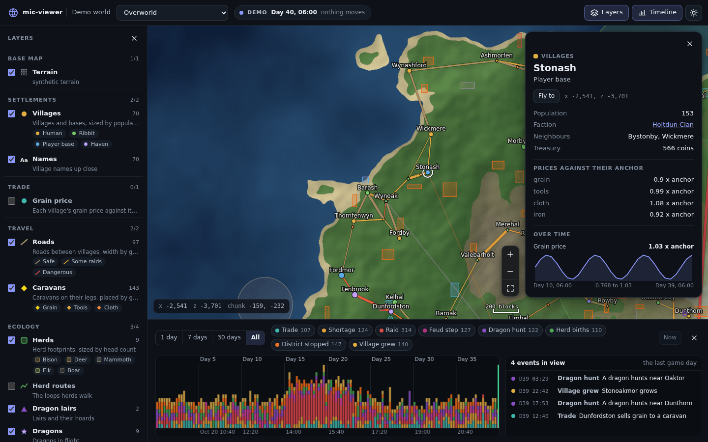
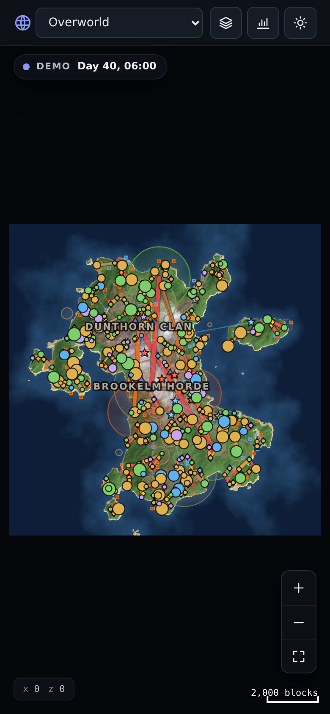
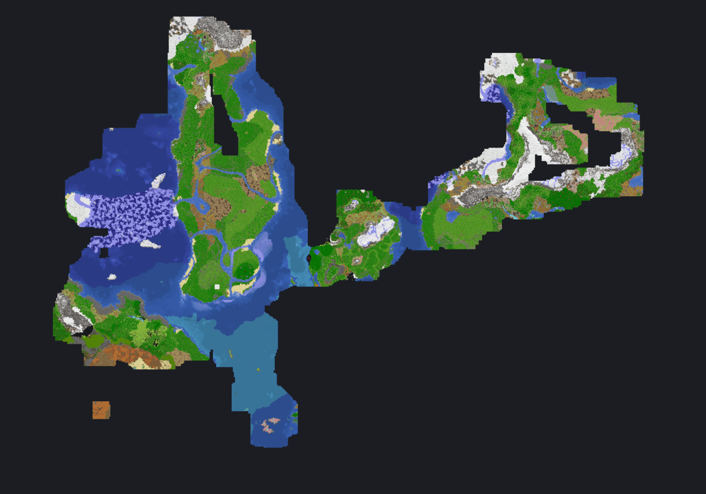
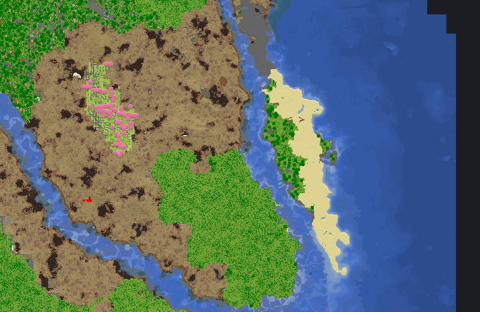

# mic-viewer

The shared world viewer of [mic-rtsim](https://github.com/MinecraftIndustrialComplex/mic-rtsim) and
[Deep Time](https://github.com/MinecraftIndustrialComplex/deep-time): a god view of a world for ops
and developers. Where things are, what happened between factions, how goods and trains move, on a
slippy map over the world's base map. Read only: nothing a page sends changes a simulation.

The design is mic-rtsim's `VIEWER.md`; this repo is its §3.1.

- `crates/mic-viewer`: one Rust library. A loopback HTTP server with a `Host` check on every
  request, server-sent events, a tile cache and the `TileSource` trait, the API's types, scenes
  (marks grouped by 512-block region) and the 2,000-mark budget, the routes over a project's
  `Backend`, and the page (`web/`, compiled in).
- `crates/mic-viewer/web`: the page. Plain classic scripts, no build step: `map.js` (the slippy map,
  from Deep Time's workbench), `flat.js`, `marks.js`, `card.js`, `timeline.js`, `app.js`.
- `crates/mic-viewer-demo`: a synthetic world served through the viewer, for the page's development,
  its screenshots and tests.
- `crates/mic-viewer-surveyor`: Surveyor's server-side terrain summaries (`<dimension>/data/surveyor/`)
  as a base map, one block a pixel: a bounded NBT reader, the region decoder (layout in mic-rtsim
  VIEWER.md §9), the renderer and a `TileSource` for the square pyramid. Read only. mic-rtsim wires it
  in at V5; `examples/render.rs` draws a world's map to one PNG.

Consumers pin a commit: mic-rtsim's `rtsim-cli view` and `rtsim-cli run`, and Deep Time's
`deeptime watch` (which vendors `crates/mic-viewer`, docs/choices-viewer.md VC4).



| Light theme | A card and the timeline | Phone |
|---|---|---|
|  |  |  |

| Surveyor base map, a server world at 4 blocks a pixel | The same at one block a pixel |
|---|---|
|  |  |

## Run the demo

```sh
nix develop -c cargo run --release -p mic-viewer-demo            # http://127.0.0.1:8740/
nix develop -c cargo run --release -p mic-viewer-demo -- --still  # a stopped clock
nix develop -c cargo run --release -p mic-viewer-demo -- --stepped 2000 --every 700  # 2000 ticks a publish, the same every run
nix develop -c cargo run --release -p mic-viewer-surveyor --example render -- <world> [dimension] [--zoom Z] --out map.png
```

From another machine, forward the port: `ssh -L 8740:127.0.0.1:8740 <host>`, then open
http://localhost:8740/.

## Security

Loopback only by default; tailnet addresses and names only with `--allow-tailnet`; no other address
is ever bound (the server refuses at start). Every request's `Host` must be a local name. The page
runs under a strict Content Security Policy. See docs/api.md §8.

## Tests

```sh
nix develop -c cargo test --workspace
nix develop -c cargo clippy --workspace --all-targets -- -D warnings
nix develop -c node --test 'tests/web/*.test.js'   # the page's pure functions (node 24 needs the glob)
nix develop -c python3 tests/web/smoke.py      # headless Chromium against the demo
```

## Docs

- docs/api.md: the routes and their JSON.
- docs/map-core.md: `map.js`'s API.
- docs/choices-viewer.md: the reversible choices made while building it, and what is Ben's call.
- docs/screenshots/: the page.

License: MPL-2.0 (NOTICE.md lists what came from Deep Time).
